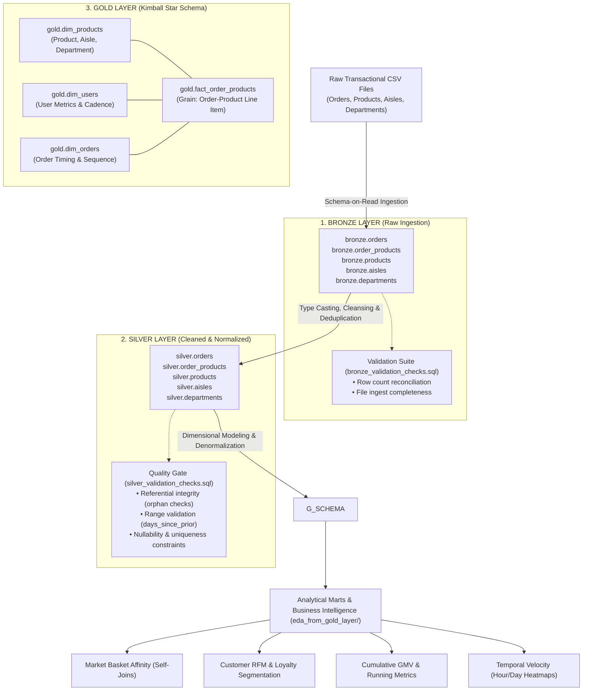

# 🛒 Instacart Medallion Analytics: Modern Lakehouse & Star-Schema Data Warehouse

[](https://www.postgresql.org/)
[-orange.svg)]()
[-blue.svg)]()
[]()
[](LICENSE)

An enterprise-grade data warehouse and dimensional modeling project implementing the **Medallion Architecture (Bronze $\rightarrow$ Silver $\rightarrow$ Gold)** on the Instacart relational transactional dataset (3.4M+ orders, 33M+ product order records). 

This repository demonstrates the end-to-end data engineering lifecycle: automated schema-on-read ingestion, progressive normalization and type casting, automated data quality assertion gates for audit readiness, Kimball star-schema dimensional modeling, and production-grade SQL analytics (Market Basket co-purchasing affinity, customer cohort segmentation, and cumulative window functions).

---

## 🏗️ 1. End-to-End Data Architecture

The warehouse organizes data across three isolated schemas (`bronze`, `silver`, `gold`) within PostgreSQL, establishing strict data quality gates at each promotion boundary:



---

## 📦 2. Layer-by-Layer Engineering Breakdown

### A. Bronze Layer: Raw Ingestion (`script_layers/bronze/`)
- **Design Philosophy**: High-fidelity ingestion retaining raw source data without truncation, casting, or data loss.
- **DDL (`bronze_ddl.sql`)**: Uses permissive data types (`VARCHAR`, `TEXT`) to ensure source records with formatting anomalies never block the ingestion pipeline.
- **Tables**: `bronze.orders`, `bronze.order_products`, `bronze.products`, `bronze.aisles`, `bronze.departments`.

### B. Silver Layer: Cleansing, Normalization & Quality Checks (`script_layers/silver/`)
- **Design Philosophy**: Single source of truth. Enforces strong typing, schema normalization, and logical consistency.
- **ETL Transformations (`load_silver.sql`)**:
  - Casts string IDs to canonical `INTEGER` and `SMALLINT`.
  - Cleans strings (trims whitespace, normalizes casing).
  - Handles missing data (e.g., standardizing `days_since_prior_order = 0` for initial customer orders).
  - Filters out uninformative cohort slices (e.g., drops redundant `eval_set` after isolating analytical cohorts).

### C. Gold Layer: Kimball Star-Schema Dimensional Modeling (`script_layers/gold/`)
- **Design Philosophy**: Optimized for analytical query performance, aggregation speed, and business reporting.
- **Fact Table**: `gold.fact_order_products`
  - Granularity: One row per product within an order.
  - Measures: `add_to_cart_order`, `reordered_flag`.
  - Keys: `order_id`, `product_id`, `user_id`.
- **Dimension Tables**:
  - `gold.dim_products`: Merges product name, aisle, and department into a consolidated dimensional hierarchy.
  - `gold.dim_orders`: Order sequence number, day-of-week, hour-of-day, and inter-purchase gap.
  - `gold.dim_users`: Aggregated lifetime order counts, user repurchase velocity, and tenure.

---

## 🛡️ 3. Continuous Control & Data Quality Validation (`validation_checks/`)

To ensure **audit readiness** and reliable evidence for compliance and business stakeholders, automated SQL validation suites execute at every layer promotion:

### Referential Integrity Assertions (`silver_validation_checks.sql`)
```sql
-- Verify ZERO orphan line-items exist in order_products
SELECT COUNT(*) AS orphan_order_products
FROM silver.order_products op
LEFT JOIN silver.orders o ON op.order_id = o.order_id
WHERE o.order_id IS NULL;
-- EXPECTED RESULT: 0

-- Verify ZERO invalid products exist in order_products
SELECT COUNT(*) AS invalid_product_count
FROM silver.order_products op
LEFT JOIN silver.products p ON op.product_id = p.product_id
WHERE p.product_id IS NULL;
-- EXPECTED RESULT: 0
```

### Business Logic & Boundary Validation
```sql
-- Ensure days_since_prior_order is within the valid operational range [0, 30]
SELECT COUNT(*) AS invalid_days_gap
FROM silver.orders
WHERE days_since_prior_order < 0 OR days_since_prior_order > 30;
-- EXPECTED RESULT: 0

-- Primary Key Uniqueness Test on Gold Fact Table
SELECT order_id, product_id, COUNT(*)
FROM gold.fact_order_products
GROUP BY order_id, product_id
HAVING COUNT(*) > 1;
-- EXPECTED RESULT: 0 rows returned
```

---

## 📈 4. Advanced SQL Analytics & Insights (`script_layers/eda_from_gold_layer/`)

### 1. Market Basket Affinity Analysis (`market_basket_analysis.sql`)
Identifies the top co-purchased item pairs using triangular self-joins to eliminate duplicate $(A, B)$ and $(B, A)$ permutations:

```sql
SELECT 
    p1.product_name AS product_a, 
    p2.product_name AS product_b, 
    COUNT(*) AS times_bought_together
FROM gold.fact_order_products fop1
JOIN gold.fact_order_products fop2 
    ON fop1.order_id = fop2.order_id 
    AND fop1.product_id < fop2.product_id   -- Eliminates mirror duplicates (A,B) vs (B,A)
JOIN gold.dim_products p1 ON fop1.product_id = p1.product_id
JOIN gold.dim_products p2 ON fop2.product_id = p2.product_id
GROUP BY p1.product_name, p2.product_name
ORDER BY times_bought_together DESC
LIMIT 15;
```

### 2. Customer Cohort & Loyalty Segmentation (`data_segmentation.sql`)
Segments users into discrete loyalty tiers based on lifetime purchase count and inter-order cadence:

```sql
WITH user_cadence AS (
    SELECT 
        user_id,
        COUNT(DISTINCT order_id) AS total_orders,
        AVG(days_since_prior_order) AS avg_days_between_orders
    FROM gold.dim_orders
    GROUP BY user_id
)
SELECT 
    user_id,
    total_orders,
    ROUND(avg_days_between_orders, 1) AS avg_cadence,
    CASE 
        WHEN total_orders >= 40 AND avg_days_between_orders <= 7  THEN 'Power VIP (Weekly)'
        WHEN total_orders >= 15 AND avg_days_between_orders <= 14 THEN 'Loyal Regular'
        WHEN total_orders >= 5  AND avg_days_between_orders <= 30 THEN 'Occasional Shopper'
        ELSE 'At-Risk / Dormant'
    END AS customer_segment
FROM user_cadence;
```

### 3. Cumulative Running Velocity (`cummulative_analysis.sql`)
Utilizes window functions to track cumulative items purchased and rolling reorder rates per customer over time:

```sql
SELECT 
    o.user_id,
    o.order_number,
    COUNT(fop.product_id) AS items_in_order,
    SUM(COUNT(fop.product_id)) OVER (
        PARTITION BY o.user_id ORDER BY o.order_number
    ) AS cumulative_items_purchased,
    ROUND(AVG(fop.reordered_flag) OVER (
        PARTITION BY o.user_id ORDER BY o.order_number 
        ROWS BETWEEN UNBOUNDED PRECEDING AND CURRENT ROW
    ), 3) AS running_reorder_rate
FROM gold.fact_order_products fop
JOIN gold.dim_orders o ON fop.order_id = o.order_id
GROUP BY o.user_id, o.order_number, fop.reordered_flag;
```

---

## 📁 5. Repository File Tree

```text
InstaCart-Medallion-Analytics/
├── datasets/                                 # Raw CSV source datasets
│   ├── aisles.csv                           # Aisle reference data
│   ├── departments.csv                      # Department reference data
│   ├── products.csv                         # Product metadata
│   └── orders.csv                           # Relational order records
│
├── script_layers/
│   ├── init_database.sql                    # Creates database and bronze/silver/gold schemas
│   ├── bronze/
│   │   └── bronze_ddl.sql                   # Raw ingestion table definitions
│   ├── silver/
│   │   ├── silver_ddl.sql                   # Standardized relational schema
│   │   └── load_silver.sql                  # Data cleansing, casting, and deduplication ETL
│   ├── gold/
│   │   ├── gold_ddl.sql                     # Kimball Star-Schema DDL (Facts & Dimensions)
│   │   └── load_gold.sql                    # Analytical transformation and loading scripts
│   └── eda_from_gold_layer/                 # Production SQL Analytical Queries
│       ├── market_basket_analysis.sql       # Cross-product basket affinity self-joins
│       ├── data_segmentation.sql            # Customer cohort & RFM segmentation
│       ├── cummulative_analysis.sql         # Cumulative window metrics & running averages
│       ├── ranking_analysis.sql             # Product & category ranking via DENSE_RANK()
│       ├── performance_analysis.sql         # Department GMV penetration & order volume
│       └── change_overtime_analysis.sql     # Hourly/weekly buying velocity trends
│
├── validation_checks/                       # Automated Quality Assurance & Audit Gates
│   ├── bronze_validation_checks.sql         # Row count parity & ingestion integrity
│   └── silver_validation_checks.sql         # Referential integrity & logical constraint checks
│
├── LICENSE                                  # MIT License
└── README.md                                # System architecture & warehouse documentation
```

---

## 🚀 6. Setup & Execution Guide

### Step 1: Initialize Database & Schemas
```bash
# Connect to PostgreSQL and create database
psql -U postgres -c "CREATE DATABASE instacart_medallion;"

# Initialize the three Medallion schemas
psql -U postgres -d instacart_medallion -f script_layers/init_database.sql
```

### Step 2: Build & Validate the Bronze Layer
```bash
# Create raw bronze tables
psql -U postgres -d instacart_medallion -f script_layers/bronze/bronze_ddl.sql

# Load raw CSVs into bronze schema (via psql \copy)
# Example: \copy bronze.orders FROM 'datasets/orders.csv' WITH (FORMAT csv, HEADER true);

# Execute bronze ingestion validation
psql -U postgres -d instacart_medallion -f validation_checks/bronze_validation_checks.sql
```

### Step 3: Transform & Gate the Silver Layer
```bash
# Define clean silver schema
psql -U postgres -d instacart_medallion -f script_layers/silver/silver_ddl.sql

# Run cleansing, normalization, and typing ETL
psql -U postgres -d instacart_medallion -f script_layers/silver/load_silver.sql

# Execute rigorous data quality gate
psql -U postgres -d instacart_medallion -f validation_checks/silver_validation_checks.sql
```

### Step 4: Populate Gold Star Schema & Run Analytics
```bash
# Define fact and dimension tables
psql -U postgres -d instacart_medallion -f script_layers/gold/gold_ddl.sql

# Populate gold star schema
psql -U postgres -d instacart_medallion -f script_layers/gold/load_gold.sql

# Execute Market Basket Analysis
psql -U postgres -d instacart_medallion -f script_layers/eda_from_gold_layer/market_basket_analysis.sql
```

---

## 💼 7. Interview & Resume Talking Points

- **Why Medallion Architecture over a single staging table?**
  > *"Separating data into Bronze, Silver, and Gold ensures strict decoupling: raw data is preserved as immutable history (Bronze), business rules and data standardization are centralized (Silver), and analytical models are isolated for high query velocity (Gold). If business logic changes, we can re-derive the Gold layer without re-ingesting raw sources."*

- **How do you guarantee data quality for non-technical auditors?**
  > *"I implemented pre-promotion validation check suites (`silver_validation_checks.sql`) executing structural assertions: referential integrity tests, boundary constraints ($0 \le \text{gap} \le 30$), and primary-key uniqueness before records enter the Gold layer. This guarantees full code lineage and formal evidence readiness."*

- **How does Star-Schema modeling accelerate query performance?**
  > *"By denormalizing product hierarchies into `gold.dim_products` and user metrics into `gold.dim_users`, analytical queries only need single-hop joins to `gold.fact_order_products`. This eliminates expensive multi-table snowflake joins, drastically improving index utilization on high-volume aggregation queries."*
